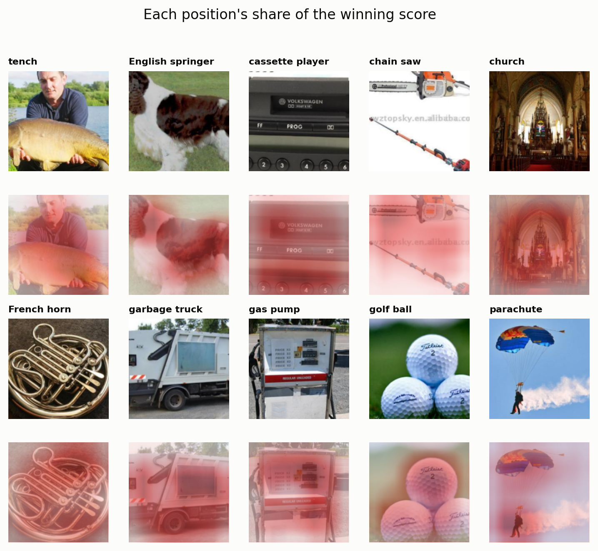
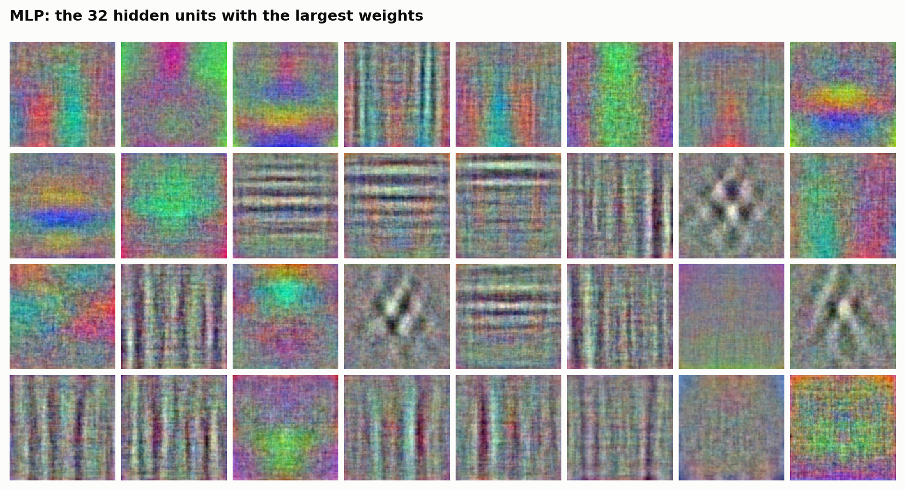
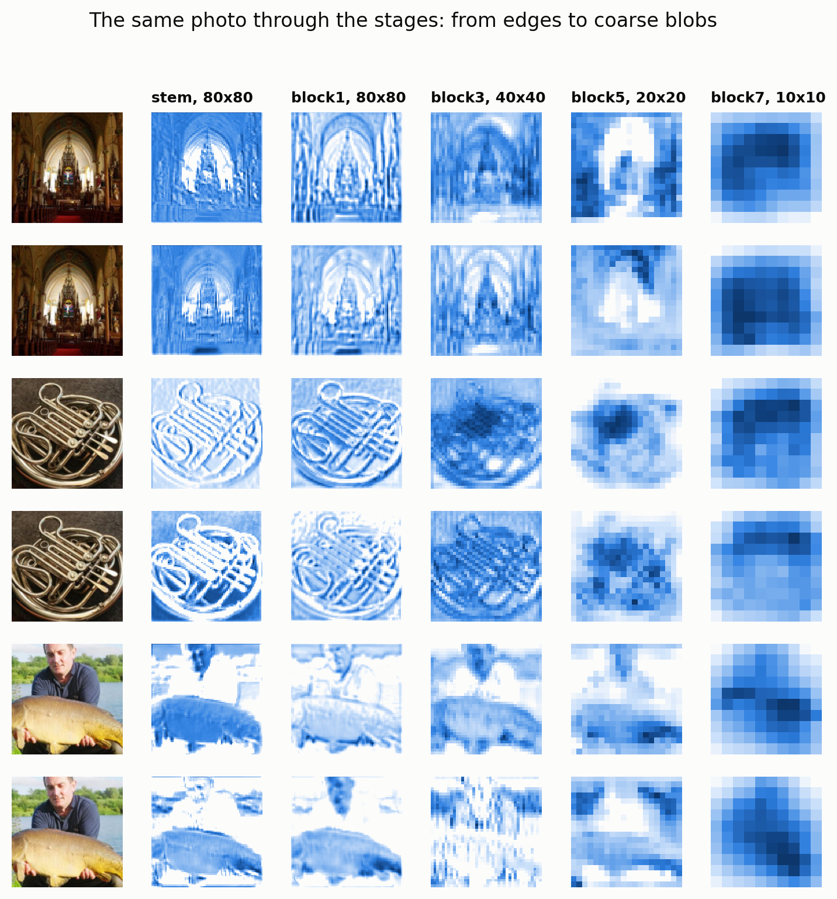
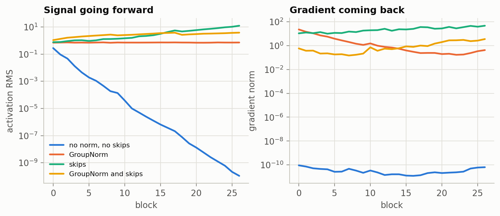
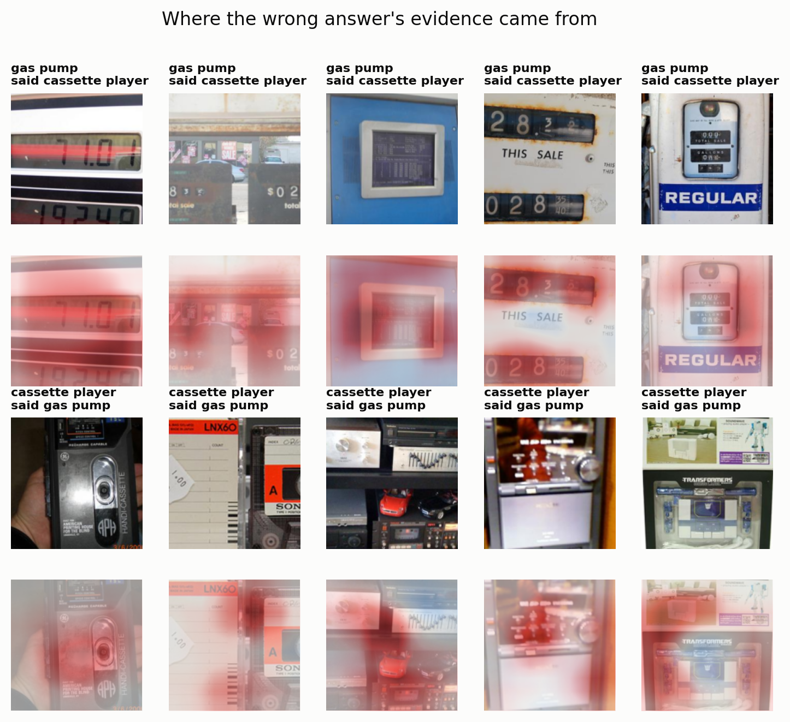

# Why does a CNN work?

*Draft. The interactive version follows one photo through the network and runs it in your
browser: [the explorer](https://claude.ai/artifact/7PHGAvw9eTgFG61rAKUhwY) (private until shared).*

A photo shows a man holding a large fish. A trained network says "tench", and it is right.
It has no notion of men or fish. It has 2.8 million numbers and 18 layers of arithmetic.
When we split its score by position, most of the evidence sits on the fish.



*Each position's share of the winning score, on the most confident correct photo of each class. Most of the evidence lands on the object.*

This post builds up to that network from the simplest image classifier on one dataset, and
at each step looks inside to see why the next idea is needed. The aim is intuition, so most
of the evidence is pictures of the model's insides, not comparisons of architectures.

## The ladder

Everything runs on Imagenette: ten easy ImageNet classes, cropped to 160x160, with 9,469
training photos and 3,925 test photos. Every model got the same recipe: 200 epochs, flips,
random resized crops, cutout, and AdamW with a cosine schedule.

| Model | Parameters | Clean train | Test |
| --- | --- | --- | --- |
| Linear | 768,000 | 36.8% | 35.5% |
| MLP, 256 hidden units | 19.7M | 63.9% | 58.1% |
| Small CNN | 368,842 | 99.3% | 82.9% |
| ResNet-18 shape | 2.8M | 100% | 87.4% |

The biggest jump is the third row. Adding convolution gains 25 points and cuts the weights
by more than 50 times. Everything after that, residual blocks and normalization and much
more depth, gains 4.5 points for about eight times the weights.

## One template per class

A linear model learns one image per class and scores a photo by how well it matches. Its
templates look like noise. A church has no single average appearance, and a template tied
to fixed pixels can't describe all the ways a church can fill the frame. It tops out at
35.5%, and it can't even fit its training set under augmentation.

## Hidden layers learn real patterns, once per place

An MLP's hidden units combine pixels into features, and it reaches 58.1%. Drawing a hidden
unit's weights as an image shows what it learned.



*These are real patterns, but each one spans the whole frame and is fixed to one place.*

Colour blobs, stripes and bars are all there. But a unit that detects a stripe here says
nothing about the same stripe over there, which needs another unit. That's where 19.7
million weights go.

We predicted that moving a photo would hurt the MLP's accuracy. It didn't: over moves of up
to 20 pixels, its accuracy stays between 55% and 60%, because the augmentation had already
shown it such moves. The damage shows up in its answers. A 5-pixel move changes 18% of the
MLP's predictions, against 6% for the small CNN and 3% for the ResNet. The MLP stays about
as accurate by being right about different photos.

## Convolution: one filter, every position

A convolution takes a small grid of weights and slides it across the image. At each position
it multiplies and adds, so the output is high where the patch matches. Two things follow.
The weights are shared, so a stripe detector works everywhere. And the output keeps the
input's layout, which makes it a map: this feature, at these places. Stack these with some
downsampling and each layer works on the previous layer's maps.

The final model looks like this:

```
photo            160 x 160 x 3
7x7 conv, stride 2  80 x 80 x 32
stage 1, 2 blocks   80 x 80 x 32
stage 2, 2 blocks   40 x 40 x 64
stage 3, 2 blocks   20 x 20 x 128
stage 4, 2 blocks   10 x 10 x 256
average over positions       256
linear                        10
```

Code: [`resnet.py`](resnet.py). The block is two 3x3 convolutions with GroupNorm, plus a skip.

## What the layers see

The trained first-layer filters are a disappointment. They're smoother than the noise they
started from, but they don't read as pictures. The responses are much easier to understand
than the weights.



*Early maps still look like the photo. Late maps are coarse blobs that say what, and only roughly where.*

The arches, the horn's tubing and the outline of the fish are all clear in the early maps.
By 10x10 the picture is gone, and what's left is a statement of what the network found.

Late units can do this because their reach grows. A unit after the first convolution can see
7 pixels across. By the last stage it can see 219, more than the whole photo. The gradient
of a central unit shows that it mostly uses the middle of that reach, as
[Luo et al.](https://arxiv.org/abs/1701.04128) found.

## Going deep breaks things

Stacking layers isn't free. These curves come from untrained 56-layer networks, so they
show what the architecture does before any learning.



*GroupNorm steadies the signal and skips steady the gradient, and the model uses both.*

With neither tool, activations fade about ten orders of magnitude by the last block, and
gradients sit near 1e-10 throughout. GroupNorm alone holds activations steady, but gradients
grow about 50 times on the way back to the first block. Skips alone keep gradients level
but let activations grow 16 times. With both, each stays within a factor of about six.

Training agrees. On CIFAR-10, after 15 epochs, a plain 56-layer network reached 34% while
the same depth with skips reached 78%.

## Where is the evidence?

The final network averages its 10x10 grid and applies one linear layer. So each class's
score is the mean of 100 per-position scores plus a bias, exactly. That's the
[class activation map](https://arxiv.org/abs/1512.04150), and with this architecture it's
arithmetic and not an approximation. The first figure in this post is that map. It mostly
lands on the object, with exceptions: the parachute's evidence sits on the skydiver and the
smoke trail, not the canopy.

## Where it fails

Chain saws and gas pumps are the weakest classes, at 78%. The most confused pair is gas pumps
and cassette players, in both directions: 24 and 22 test photos.



*Both classes are boxes covered in small panels, labels and readouts.*

The evidence for the wrong class gathers around those panels. That's a suggestion from a
handful of maps, not a measured cause, but it's a better explanation than the accuracy table
gives.

The model is also sure of itself. It's at 100% on clean training images, and its median top
probability is 99.98% on correct test photos and still 78.5% on wrong ones.

## What surprised us

- **Accuracy hid the shift problem.** The MLP's flat accuracy curve looked like a refuted
  prediction, until we counted how many answers changed.
- **Gradients didn't vanish with GroupNorm.** Our notes said they faded toward the input.
  Plotted block by block, they grow instead.
- **Every pixel technically reaches every unit.** GroupNorm's statistics cover the whole
  image, so a test that checked the receptive field against gradients failed until
  normalization was removed.
- **Residual blocks aren't small edits.** On the trained model the residual path is about as
  large as the skip, and more than five times larger in the last block.
- **The test set had a hidden order.** Our loader dropped the last partial batch, which on
  an unshuffled set removed one class. Shuffling at load fixed it.
- **Resuming needed a permission that saving didn't.** Checkpoints in a fresh bucket folder
  worked, but resuming needed read access to the bucket's metadata. The small CNN paused at
  epoch 100 until that was granted.

Training ran on a Colab TPU (`v5e1`) at about 6.5 steps per second, limited by image
augmentation, so 200 epochs took about 40 minutes.

## Try it yourself

Rebuild every figure from the checkpoints:

```bash
GOOGLE_CLOUD_PROJECT=practicalml-db49f uv run python -m toylib_projects.p01_cnn_mnist.figures
```

Then upload your own photo to the explorer and cover the part you think matters. Try
something outside the ten classes, and see how sure it still is.
